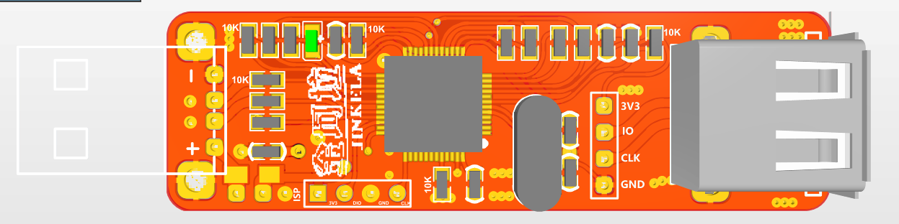
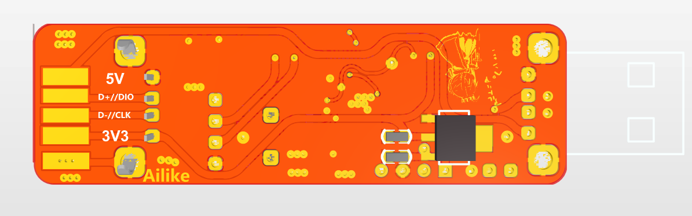

# STM32F103 Hardware Reference

[中文](./readme.md) | **English**

This directory retains hardware reference material. It does not provide J-Link software, firmware, or feature-licensing procedures. Hardware files do not grant a license to use SEGGER proprietary software.

| File | Description |
|------|------|
| [Schematic](<./2012版本(v7版)/Schematic_temp_ARM-OB_20180808014643.pdf>) | Schematic |
| `2012版本(v7版)/jlinkv7_pcb/jlink.PcbDoc` | Altium PCB |
| `2012版本(v7版)/jlinkv7_pcb.7z` | Archive containing the PCB document |

Existing attribution and applicable licenses are retained; this cleanup grants no new license. Some historical files have no explicit license, so confirm permission with the relevant rightsholder before use or redistribution.
