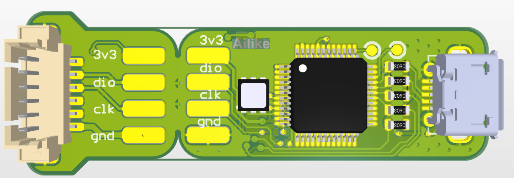
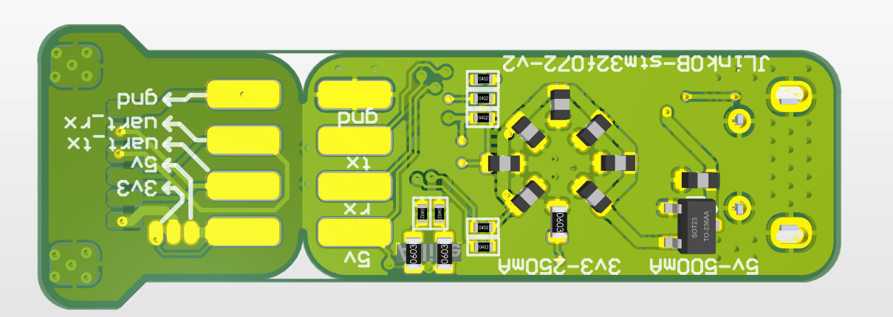

# STM32F072 硬件工程

**中文** | [English](./readme_en.md)

本目录保留硬件参考资料，不提供 J-Link 软件、固件或授权功能配置方法。硬件资料不构成使用 SEGGER 专有软件的授权。

| 文件 | 说明 |
|------|------|
| `JlinkOB_PCB_Project.PrjPcb` | Altium 工程文件 |
| `Sheet.SchDoc` | 原理图 |

资料沿用原作者署名和已有许可；本次整理不授予新的许可证。部分历史资料未附明确许可，使用或再分发前应向相应权利人核实。
