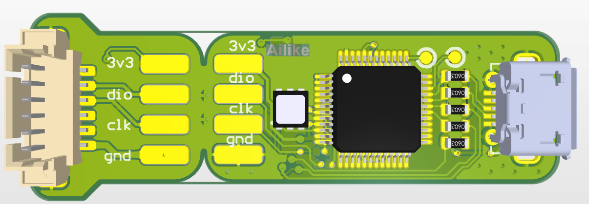
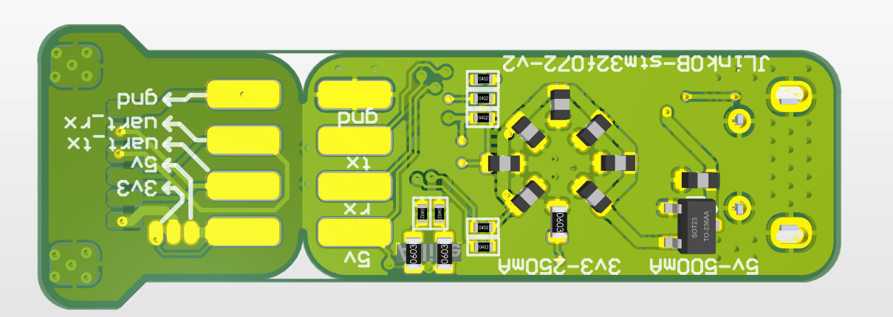

# STM32F072 Hardware Project

[中文](./readme.md) | **English**

This directory retains hardware reference material. It does not provide J-Link software, firmware, or feature-licensing procedures. Hardware files do not grant a license to use SEGGER proprietary software.

| File | Description |
|------|------|
| `JlinkOB_PCB_Project.PrjPcb` | Altium project file |
| `Sheet.SchDoc` | Schematic |

Existing attribution and applicable licenses are retained; this cleanup grants no new license. Some historical files have no explicit license, so confirm permission with the relevant rightsholder before use or redistribution.
