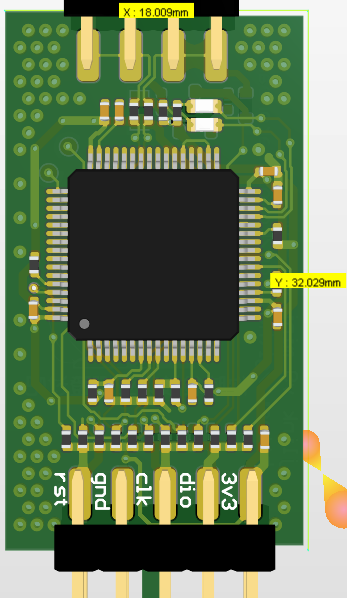
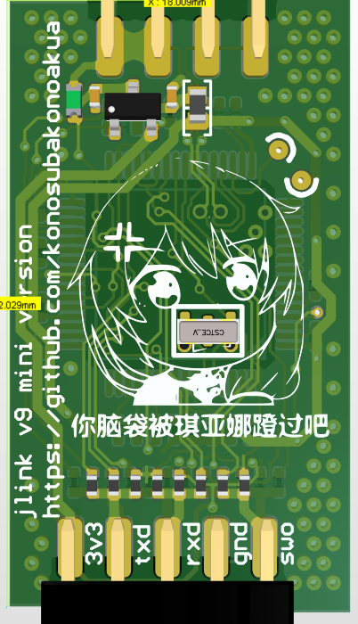
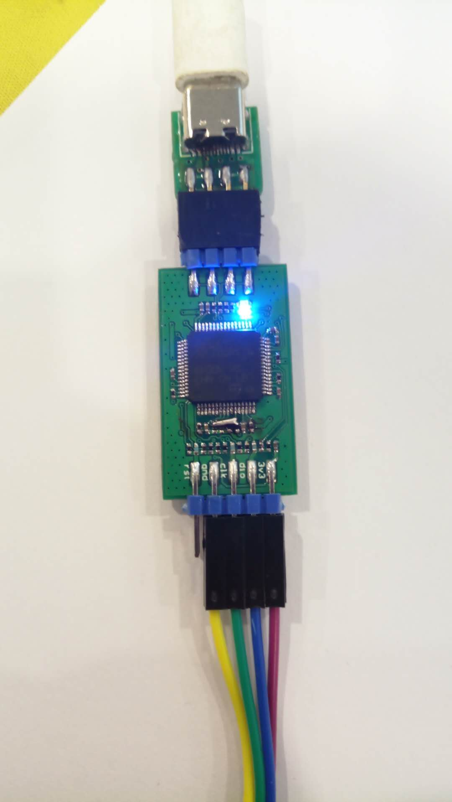
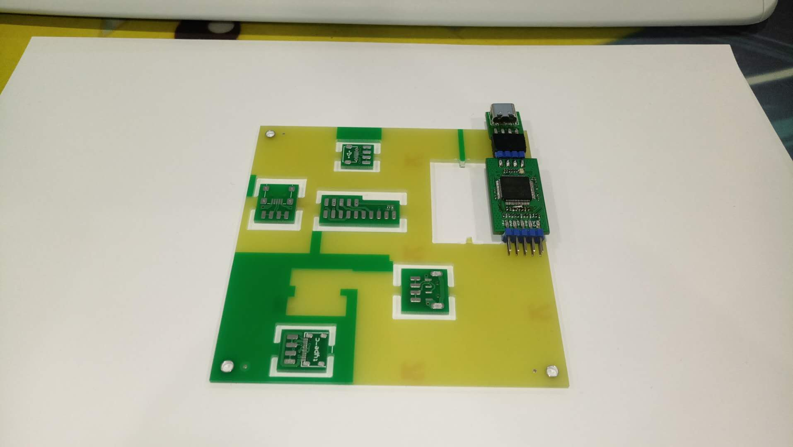
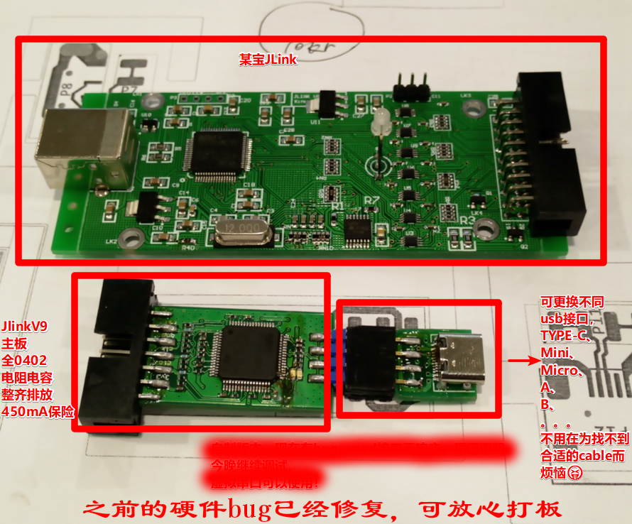
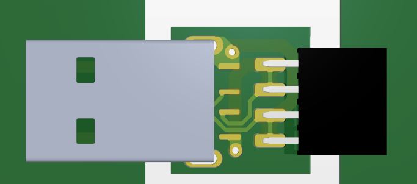
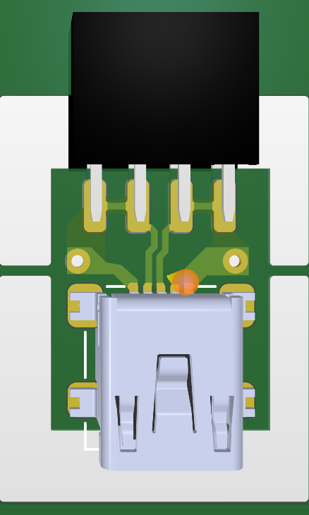
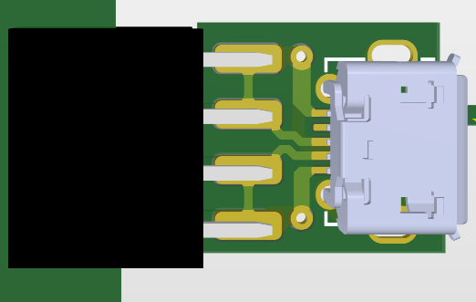
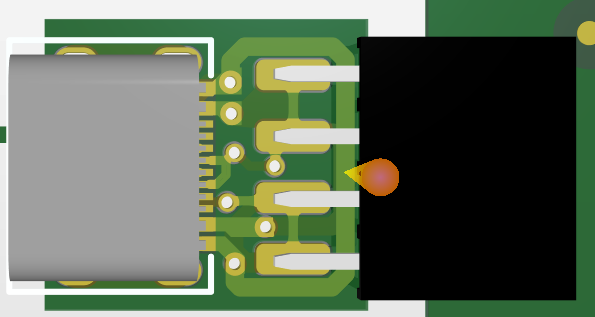
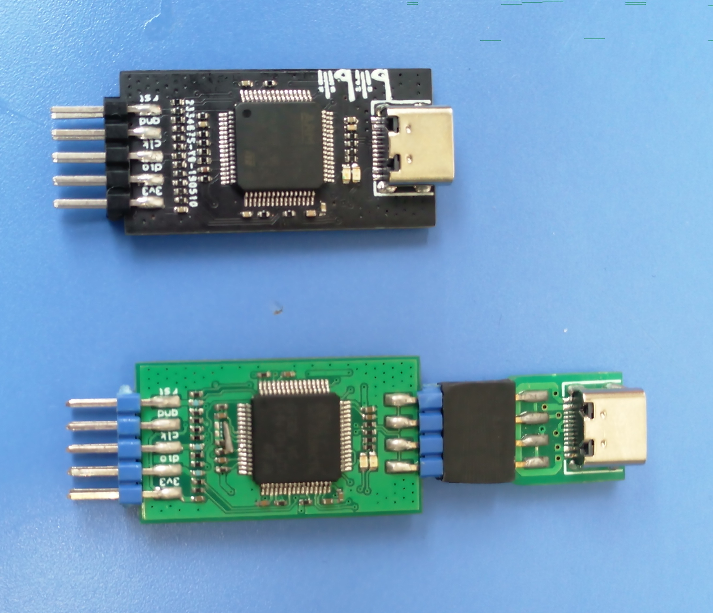

# V9 硬件参考

**中文** | [English](./readme_en.md)

本目录保留硬件参考资料，不提供 J-Link 软件、固件或授权功能配置方法。硬件资料不构成使用 SEGGER 专有软件的授权。

## 规格

| 项目 | 详情 |
|------|------|
| **MCU** | 以所选原理图版本为准 |
| **接口** | SWD + JTAG + VCP (虚拟串口) |

## 资料清单

| 文件 | 说明 |
|------|------|
| [制作资料/JlinkV93.pdf](<./制作资料/JlinkV93.pdf>) | 原理图 |
| [制作资料/Jlinkv9mini_latest.pdf](<./制作资料/Jlinkv9mini_latest.pdf>) | V9 Mini 原理图 |
| `制作资料/jlinkv9mini_latest.7z` | V9 Mini PCB 工程（最新版，已打板验证） |
| `制作资料/jlinkv9_only_usbc.7z` | USB-C 专版 PCB 工程 |
| `制作资料/jlinkv9_taobao_version.7z` | 淘宝版 PCB 工程 |
| `制作资料/bom.xls` | BOM 表 |
| [制作资料/top asm.pdf](<./制作资料/top asm.pdf>)、[btm asm.pdf](<./制作资料/btm asm.pdf>) | 装配图（正/反面） |

## 版本说明

- **初版**：多 USB 接口 + 排针组合（micro-USB / mini-USB / USB-C）
- **USB-C 专版**：仅 USB-C 接口，长时间插拔更可靠（`jlinkv9_only_usbc.7z`）
- **V9 Mini（最新版）**：已验证打板（`jlinkv9mini_latest.7z`），另见 [JlinkV9 mini](<../JlinkV9 mini/readme.md>) 独立项目

## 效果图

上图是 AD 渲染图，实际效果如下：

工程文件在压缩包里。

## 更新记录

之前使用多种 USB 接口 + 排针的方式，实际使用中拔插次数多了可能导致接触不良：

故更新一版只有 Type-C 接口的，PCB 文件是 `jlinkv9_only_usbc.PcbDoc`，效果如下（嘉立创🐂🍺，哑光黑不要钱）：

## 来源与许可

资料沿用原作者署名和已有许可；本次整理不授予新的许可证。部分历史资料未附明确许可，使用或再分发前应向相应权利人核实。
