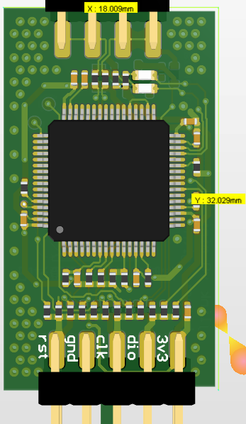
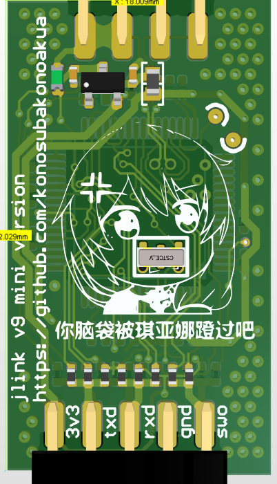
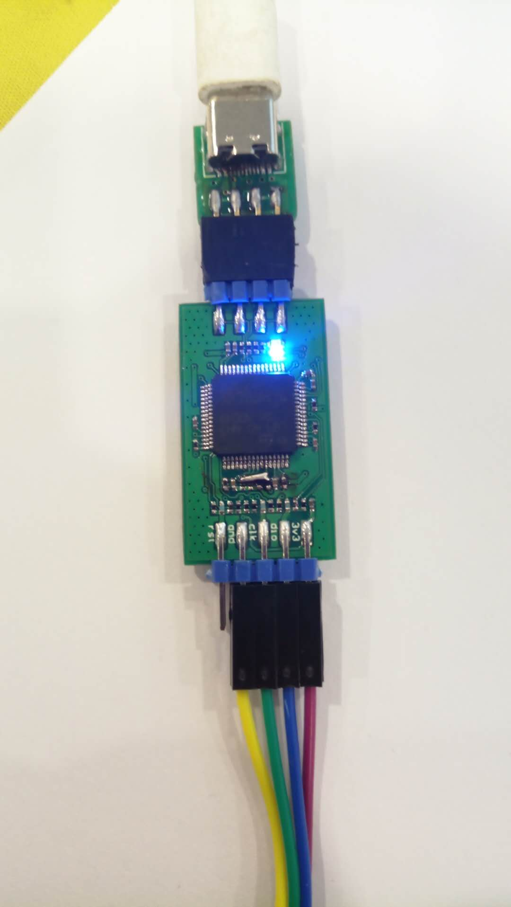
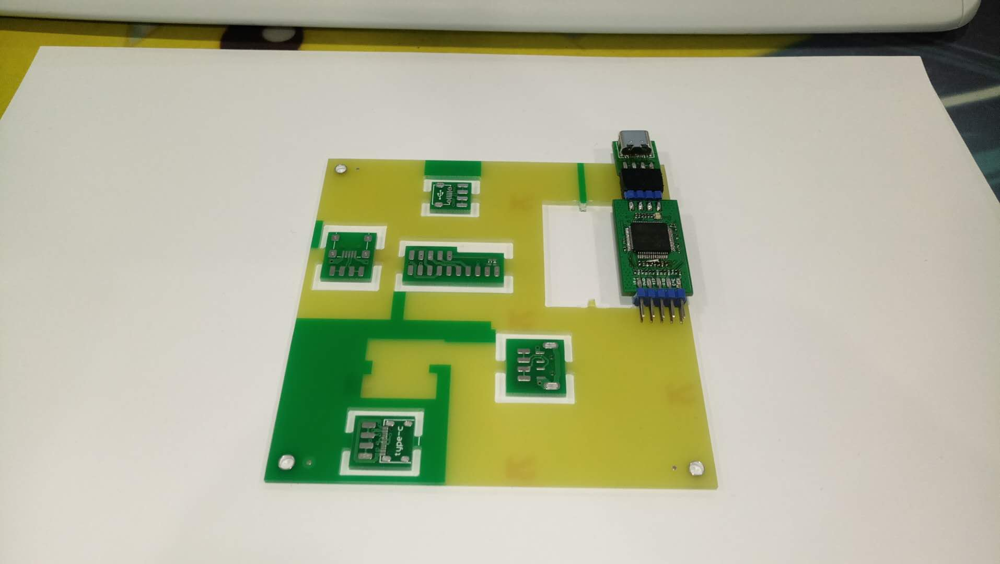
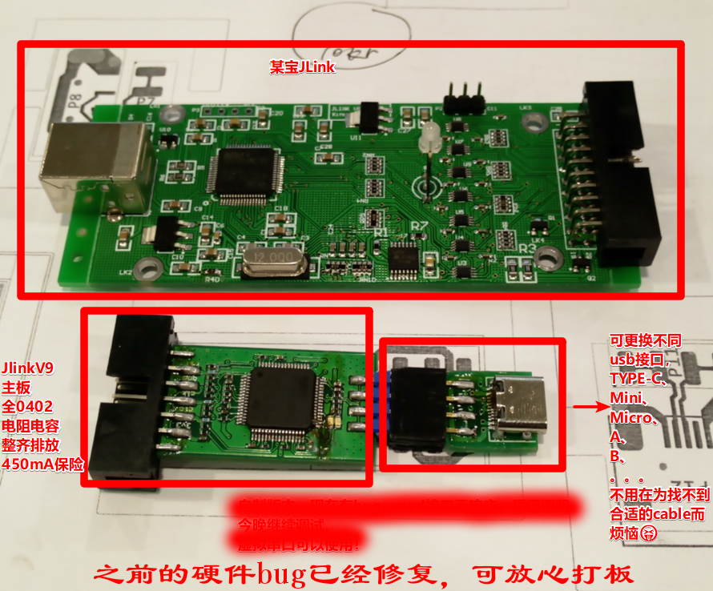
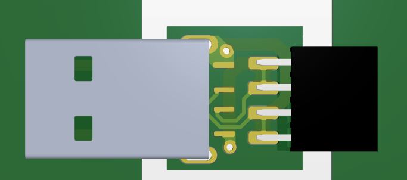
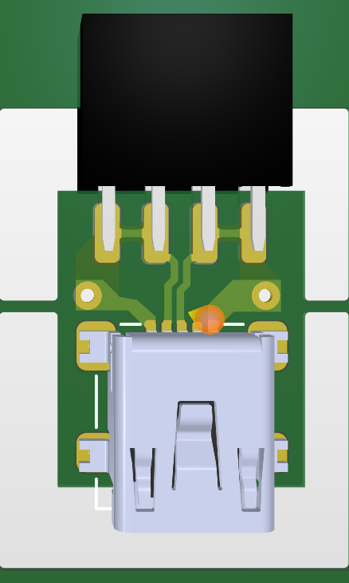
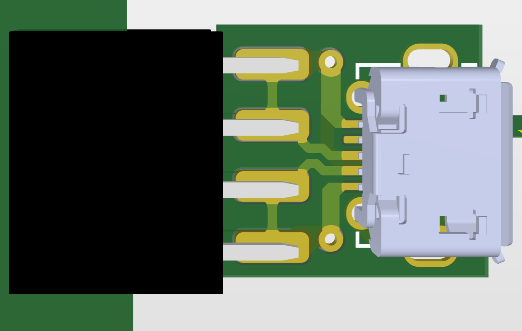
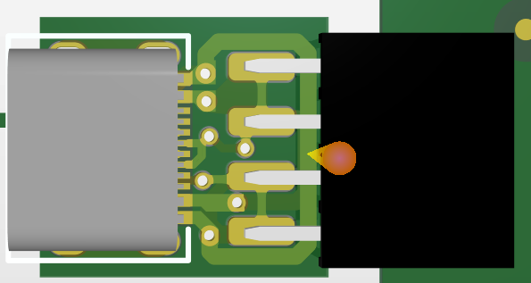
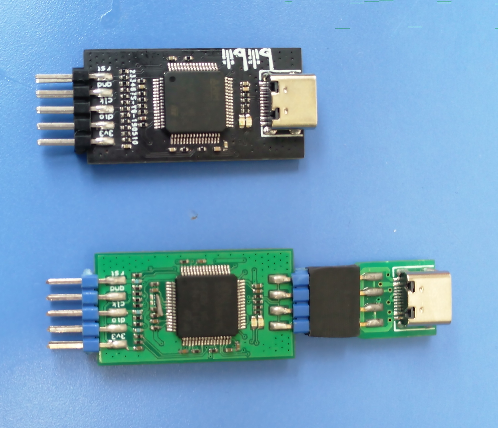

# V9 Hardware Reference

[中文](./readme.md) | **English**

This directory retains hardware reference material. It does not provide J-Link software, firmware, or feature-licensing procedures. Hardware files do not grant a license to use SEGGER proprietary software.

## Specifications

| Item | Details |
|------|---------|
| **MCU** | See the selected schematic revision |
| **Interfaces** | SWD + JTAG + VCP (virtual COM port) |

## File manifest

| File | Description |
|------|-------------|
| [制作资料/JlinkV93.pdf](<./制作资料/JlinkV93.pdf>) | Schematic |
| [制作资料/Jlinkv9mini_latest.pdf](<./制作资料/Jlinkv9mini_latest.pdf>) | V9 Mini schematic |
| `制作资料/jlinkv9mini_latest.7z` | V9 Mini PCB project (latest, board-verified) |
| `制作资料/jlinkv9_only_usbc.7z` | USB-C-only PCB project |
| `制作资料/jlinkv9_taobao_version.7z` | Taobao-version PCB project |
| `制作资料/bom.xls` | BOM |
| [制作资料/top asm.pdf](<./制作资料/top asm.pdf>), [btm asm.pdf](<./制作资料/btm asm.pdf>) | Assembly drawings (top/bottom) |

## Variants

- **Original**: multiple USB connectors + pin headers (micro-USB / mini-USB / USB-C)
- **USB-C-only**: single USB-C connector, more reliable under repeated plugging (`jlinkv9_only_usbc.7z`)
- **V9 Mini (latest)**: board-verified (`jlinkv9mini_latest.7z`); see also the standalone [JlinkV9 mini](<../JlinkV9 mini/readme_en.md>) project

## Renders & photos

The above are Altium renders; actual boards below:

Project files are inside the archives.

## Revision notes

The earlier design combined multiple USB connectors + pin headers, which could develop contact issues after many plug cycles:

So a USB-C-only revision was made — PCB file `jlinkv9_only_usbc.PcbDoc` (JLCPCB matte black, free of charge 🐂🍺):

## Source and license

Existing attribution and applicable licenses are retained; this cleanup grants no new license. Some historical files have no explicit license, so confirm permission with the relevant rightsholder before use or redistribution.
