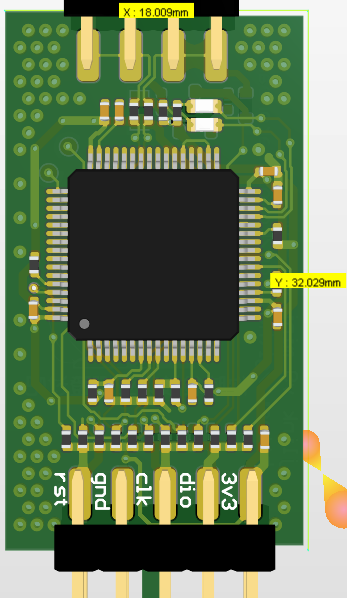
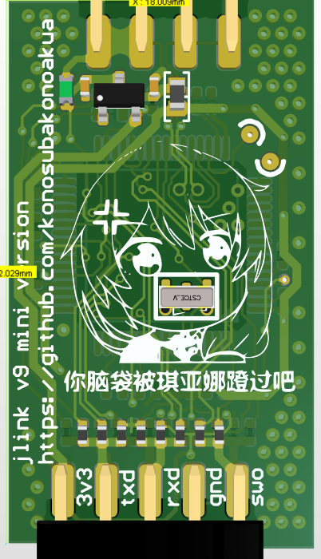
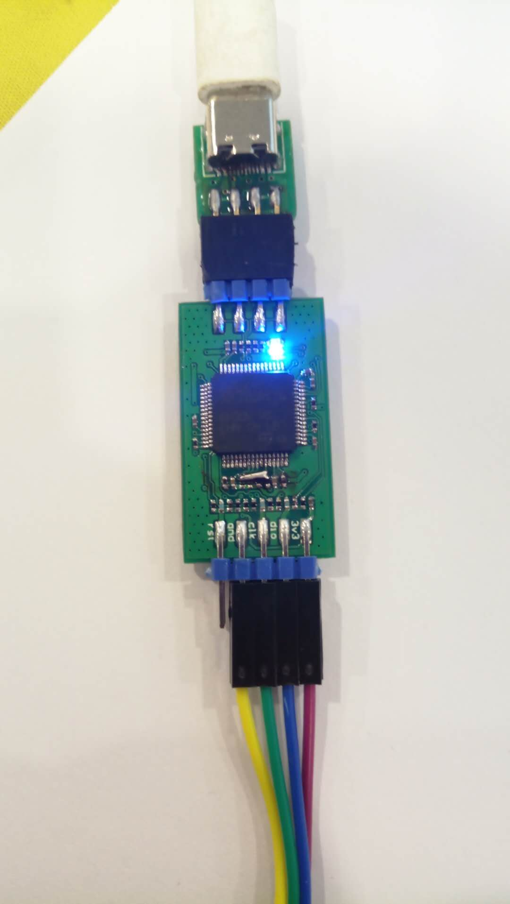
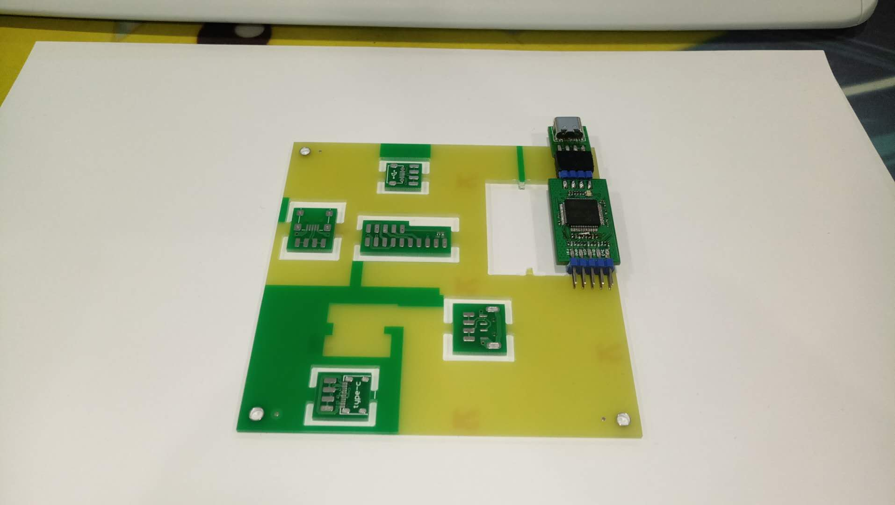
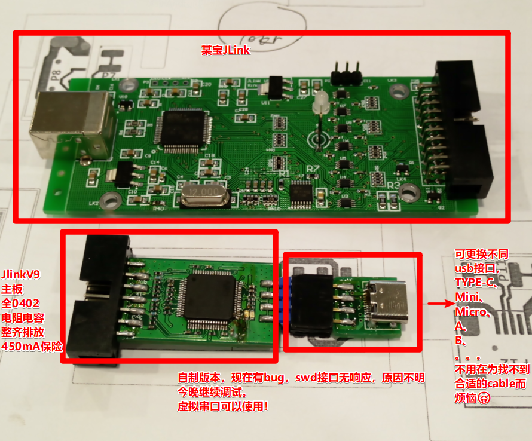
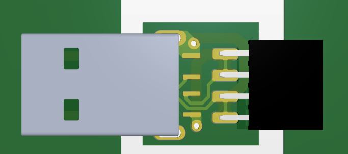
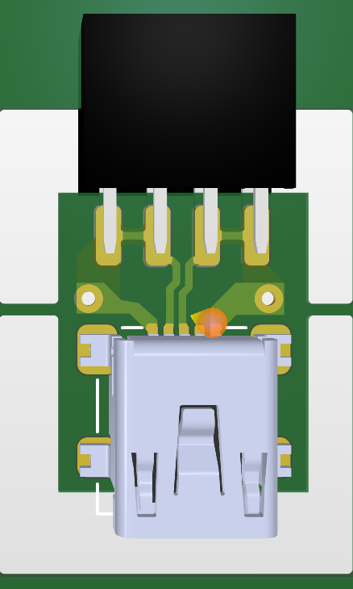
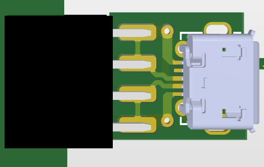
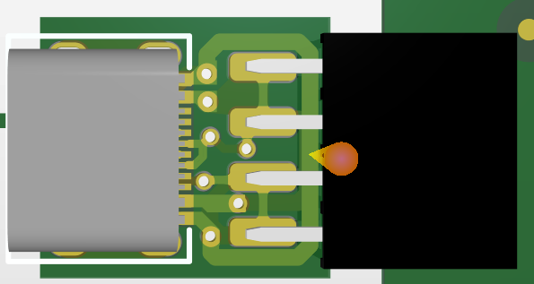
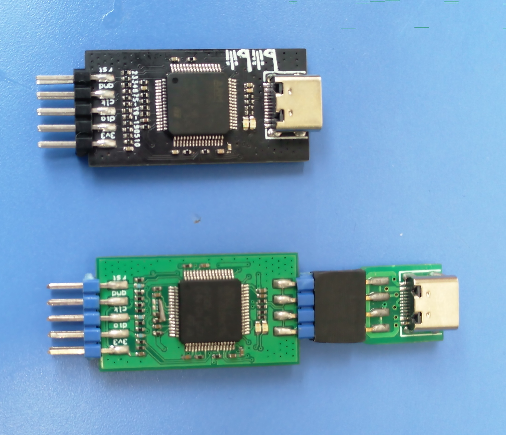

# :anchor:JLinkV9制作:anchor:

## :1st_place_medal:效果图:framed_picture:

上图是ad渲染图，实际效果如下

工程文件在压缩包里

------

## :3nd_place_medal:更新
之前使用多种USB接口+排针的方式，实际使用中拔插次数多了可能会导致接触不良，
故更新一版只有typec接口的，PCB文件是`jlinkv9_only_usbc.PcbDoc` 效果如下（嘉立创🐂🍺，哑光黑不要钱）：

